# Antes: versión de teléfono al 2026-11-18

Capturas tomadas durante la revisión (`revision.md`), antes de los arreglos de la rama `movil`. Sirven para comparar con `despues.md`.

- **Teléfono:** Samsung S24 Ultra por Wi-Fi contra `pnpm dev:demo`, visto en Enlace Móvil.
- **360 px / 320 px:** navegador simulando un teléfono de ese ancho. A 320 px es parecido a un teléfono con la letra grande.
- El botón naranja "N" es el aviso de Next.js en desarrollo, no es parte de la app.
- Las capturas de la PC salen en modo oscuro porque ese era el tema activo. En las de 360 px las animaciones están apagadas para capturar la pantalla ya completa.

Para el "después", toma la misma pantalla al mismo ancho y guárdala en `despues/` con el mismo número (`09-tareas-320px-lista.png`). Así se comparan en orden.

## Arreglo del modo demo por Wi-Fi

| # | Captura | Qué muestra |
| --- | --- | --- |
| 02 | 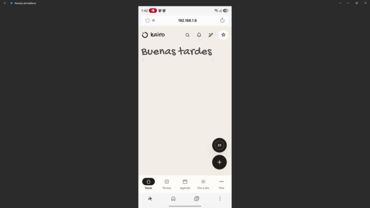 | Desde el teléfono, la página cargaba vacía: Next.js bloqueaba su JavaScript de desarrollo. |
| 03 | 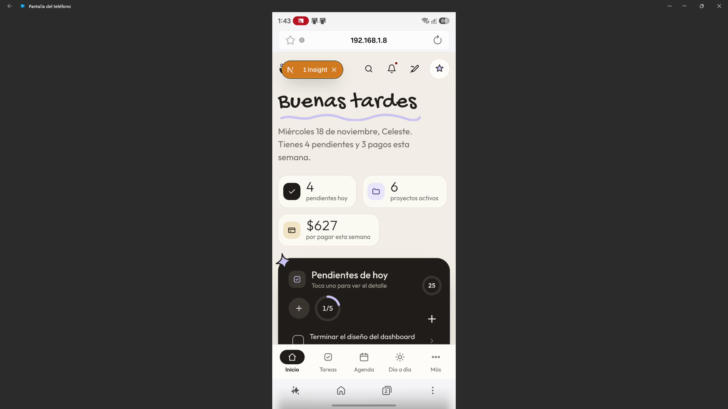 | La misma pantalla después de agregar `allowedDevOrigins` en `apps/web/next.config.ts`. |

## Inicio

| # | Captura | Qué muestra |
| --- | --- | --- |
| 01 | 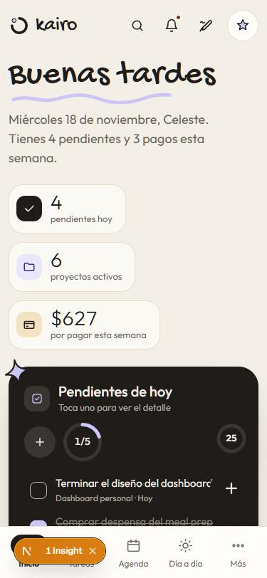 | Tarjetas de números en 2 + 1 con huecos; el "25" encima de "Pendientes de hoy". |
| 04 | 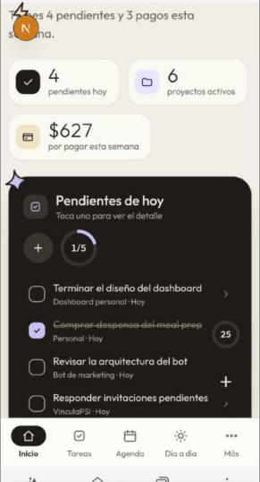 | En el teléfono: el "25" tapa las flechas de las tareas. |

## Perfil

| # | Captura | Qué muestra |
| --- | --- | --- |
| 05 | 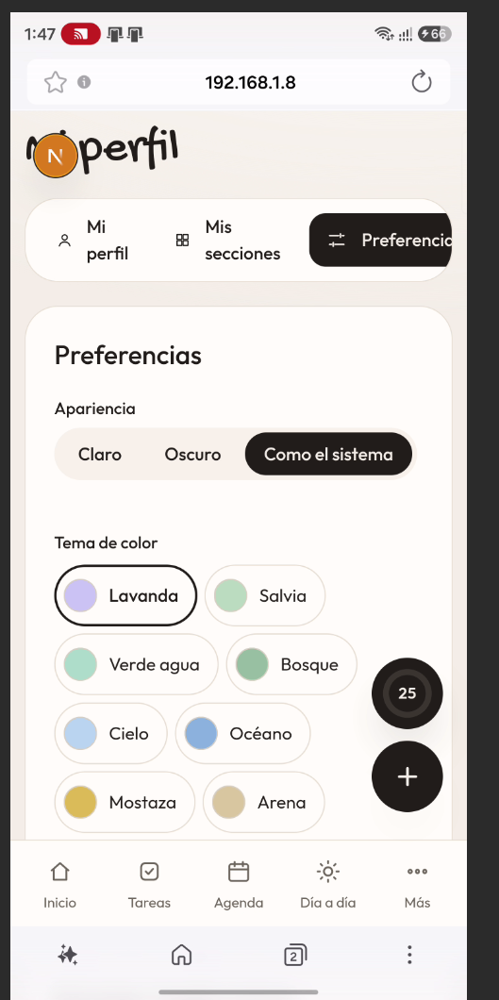 | En el teléfono: pestañas cortadas ("Preferencia…"), texto en dos renglones y el + encima de los temas de color. |
| 06 | 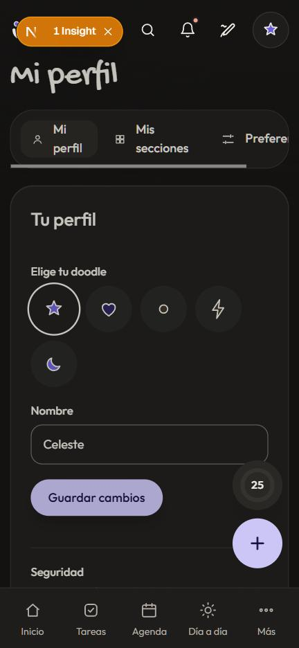 | Lo mismo a 360 px; el "25" queda junto a "Guardar cambios". |

## Tareas

| # | Captura | Qué muestra |
| --- | --- | --- |
| 07 | 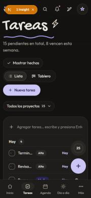 | Encabezado y primeras filas: los nombres ya empiezan cortados ("Termin…"). |
| 08 | 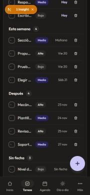 | La lista completa: nombres de 5–6 letras, la prioridad se come el espacio. |
| 09 | 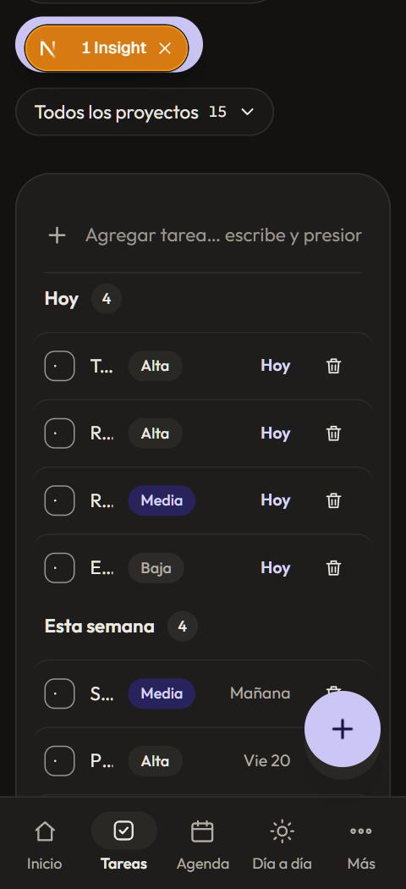 | A 320 px los nombres quedan en una letra ("T…") y el + tapa la fecha. |

## Agenda y Día a día

| # | Captura | Qué muestra |
| --- | --- | --- |
| 10 | 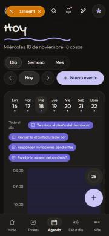 | Tareas de "Todo el día" cortadas; los botones flotantes sobre la columna de horas. |
| 11 | 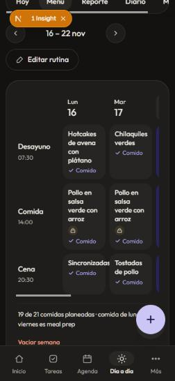 | Menú semanal: se ven 2 de 7 días, comidas de 4 renglones, pestañas cortadas arriba. |

## Finanzas

| # | Captura | Qué muestra |
| --- | --- | --- |
| 12 | 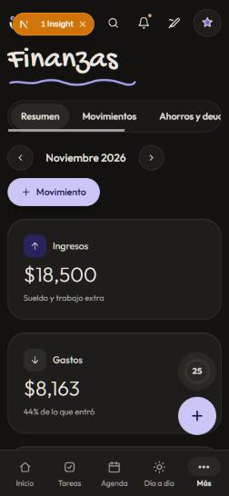 | Pestañas cortadas ("Ahorros y deu…"); el "25" junto a la tarjeta de Gastos. |
| 13 | 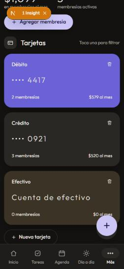 | Membresías: el + tapa "$0 al mes" de la tarjeta de efectivo. |

## Proyectos

| # | Captura | Qué muestra |
| --- | --- | --- |
| 14 | 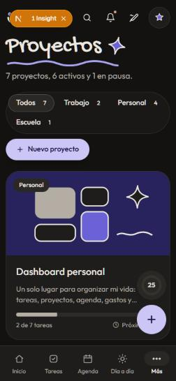 | Filtros en dos renglones; el "25" y el + sobre la tarjeta del proyecto. |
| 15 | 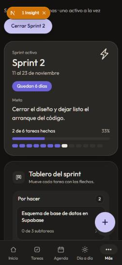 | Pestañas del proyecto apenas cortadas; botones flotantes sobre el sprint activo. |
| 16 | 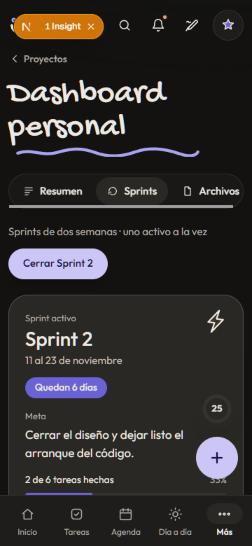 | Tablero del sprint apilado; el + tapa las tarjetas. |

## Escuela

| # | Captura | Qué muestra |
| --- | --- | --- |
| 17 | 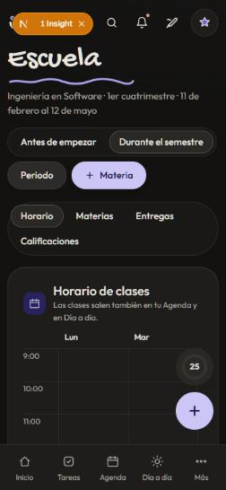 | Del horario solo se ven Lunes y Martes; "Calificaciones" baja sola a otro renglón. |

## Escritos

| # | Captura | Qué muestra |
| --- | --- | --- |
| 18 | 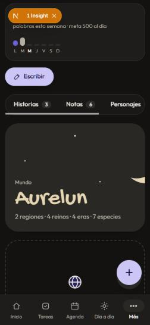 | Pestañas de Escritos cortadas ("Personaje…"). |
| 19 | 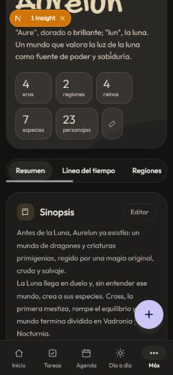 | Pestañas del mundo (804 px) se deslizan sin pista; el + sobre la sinopsis. |
| 20 | 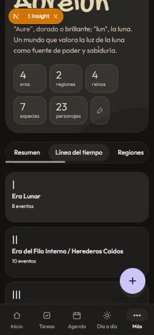 | Línea del tiempo: las eras se apilan bien; mismas pestañas cortadas. |

## Recordatorios, Papelera y menú "Más"

| # | Captura | Qué muestra |
| --- | --- | --- |
| 21 | 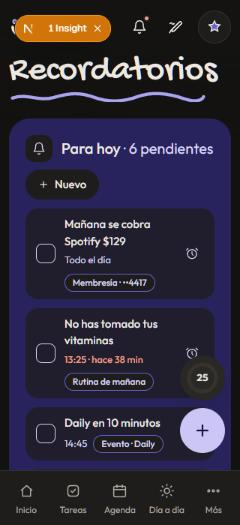 | El "25" y el + tapan los íconos de alarma. |
| 22 | 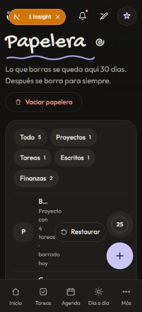 | El nombre queda en una letra ("B…") y la descripción en una palabra por renglón. |
| 23 | 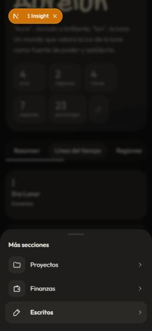 | La hoja "Más" solo trae Proyectos, Finanzas y Escritos: faltan Escuela y Recordatorios. |
